<p align="right">
  <a href="https://hradecheck.com"></a>
  <a href="https://www.linkedin.com/in/ivohradek"></a>
  <a href="https://stackoverflow.com/users/772992/hradecek"></a>
  <a href="https://www.instagram.com/hradecek"></a>
  <a href="https://www.chess.com/member/hradecheck"></a>
</p>

<p align="center">
  
</p>

<p align="center">
Hello! 👋 My name is Ivo Hrádek [<a href="./assets/audio/name_pronunciation.mp4?raw=true"></a> <samp>ˈɪvo ˈɦraːdɛk</samp>].<br>
I build backend systems on the JVM, run them on Kubernetes, and write about it at <a href="https://hradecheck.com">hradecheck.com</a>.
</p>

## `$ cat about.kt`

```kotlin
val ivo = Engineer(
    role     = "Backend engineer & tech lead",
    based    = "Brno, Czech Republic",
    builds   = listOf("Kotlin", "Spring Boot", "Gradle"),
    ships    = listOf("Kubernetes", "Helm", "ArgoCD", "Azure", "Terraform", "GitHub Actions"),
    observes = listOf("OpenTelemetry", "Micrometer"),
    focus    = listOf(
        "architecture and ADRs",
        "platform, GitOps and delivery",
        "identity: OAuth2, OIDC, JWT, consent",
        "documentation that stays true",
    ),
    offDuty  = listOf("chess", "writing"),
)
```

## `$ ls ~/projects`

| Project | What it is |
| --- | --- |
| [jotscope](https://github.com/hradecek/jotscope) | Privacy-first Chrome extension to decode, inspect and verify JSON Web Tokens. 100% offline. [jotscope.hradecheck.com](https://jotscope.hradecheck.com) |
| [hradecheck.com](https://github.com/hradecek/hradecheck-com) | My blog: software architecture, system design and building reliable software. |
| [dotfiles](https://github.com/hradecek/dotfiles) | Home is where the config files are. |
| [apk2xml](https://github.com/hradecek/apk2xml) | Converter between Android binary XML and readable XML. |

## `$ cat stack`

<p align="center">
  <picture>
    <source media="(prefers-color-scheme: dark)" srcset="https://skillicons.dev/icons?i=kotlin%2Cjava%2Cspring%2Cgradle%2Cpostgres%2Ckafka%2Cjs%2Cpy%2Ckubernetes%2Cdocker%2Cazure%2Cterraform%2Cgithubactions%2Cgrafana%2Cprometheus%2Clinux%2Cbash%2Cpowershell%2Cgit%2Cidea%2Cobsidian%2Craspberrypi&perline=11&theme=dark">
    
  </picture>
</p>

## `$ git log --stat`

<p align="center">
  
</p>
